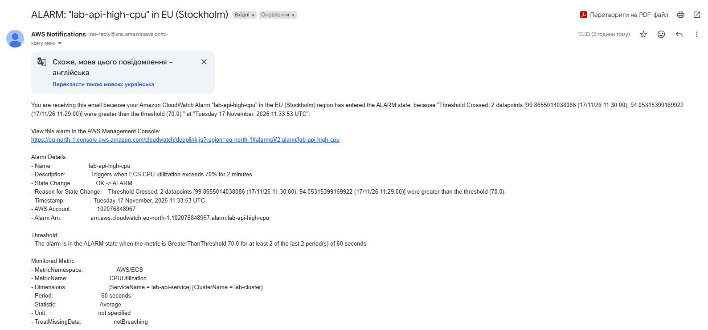
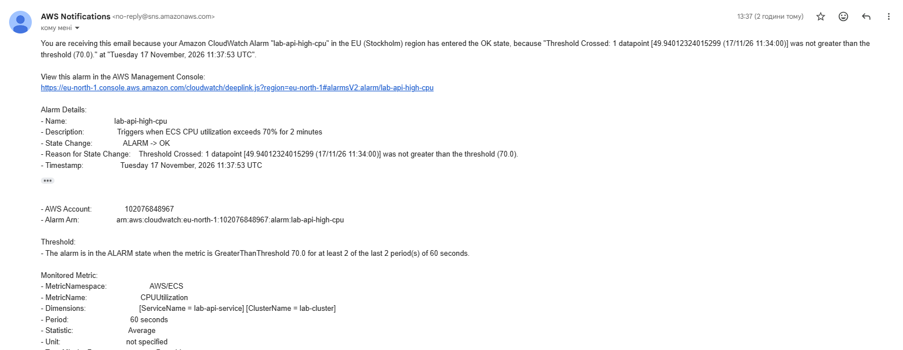

# Сповіщення

## Умова

Правило тривоги `lab-api-high-cpu` описане у файлі `terraform/monitoring.tf` ресурсом `aws_cloudwatch_metric_alarm.ecs_high_cpu_alarm`. Сповіщення активується, коли середнє завантаження процесора сервісу ECS утримується вище `70%` протягом 2 хвилин поспіль.

| Параметр | Значення |
|---|---|
| Метрика | `CPUUtilization` (`AWS/ECS`, сервіс `lab-api-service`), статистика `Average` |
| Поріг | `> 70%` |
| Період | `60 с`, `2 періоди поспіль` |
| Канал | SNS-топік `lab-api-alerts`, підписка `email` |
| Дії | `alarm_actions` (перехід у `ALARM`) та `ok_actions` (повернення в `OK`) |

Поріг `70%` встановлено вище за цільовий рівень автоскейлінгу (`60%`), щоб штатне розширення сервісу не створювало зайвого шуму, а інженер отримував сигнал лише тоді, коли навантаження зростає швидше, ніж запускаються нові контейнери. Перевірка протягом 2 хвилин поспіль відсіює короткочасні сплески.

## Листи

| Подія | Час |
|---|---|
| Початок навантаження | 13:28:00 |
| Перший перетин порогу 70% (`94,05%`) | 13:29:00 |
| Початок сталого навантаження | 13:31:00 |
| Лист `ALARM` | 13:33:53 |
| Зниження CPU нижче 70% після масштабування (`49,94%`) | 13:34:00 |
| Лист `OK` | 13:37:53 |

## Час реакції

Від початку сталого навантаження (`13:31:00`) до отримання листа `ALARM` (`13:33:53`) минуло **2 хв 53 с** (а від першого перетину порогу `70%` о `13:29:00` — **4 хв 53 с**).

Затримка складається з:
- двох інтервалів по 60 с, необхідних для підтвердження умови спрацювання тривоги;
- затримки агрегації та надходження метрик `AWS/ECS` у CloudWatch (1–2 хв);
- надсилання електронного листа через Amazon SNS (кілька секунд).

## Оцінка

Для навчального стенду або внутрішнього сервісу час реакції близько 3 хвилин є прийнятним: система відфільтровує випадкові піки та попереджає про перевантаження раніше, ніж виникають помилки `5xx`, поки Auto Scaling паралельно додає контейнери. Для критичного продакшн-сервісу зі строгим SLA така затримка завелика — користувачі встигнуть відчути падіння швидкодії до надходження листа, тому там доцільно використовувати частіший крок метрик (10–30 с) і миттєві канали сповіщень (Slack, PagerDuty).