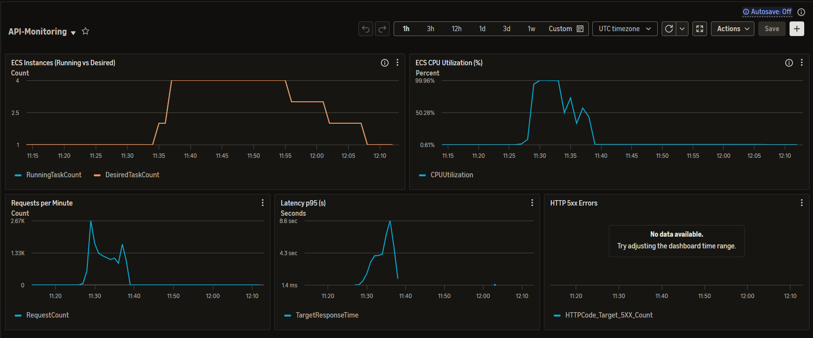

# Автомасштабування

## Параметри політики

| Параметр | Значення | Призначення |
|---|---|---|
| Мінімум екземплярів | `1` | Підтримка постійної доступності API у стані спокою |
| Максимум екземплярів | `4` | Верхнє обмеження кількості задач за умовою роботи |
| Метрика | `ECSServiceAverageCPUUtilization` | Середнє завантаження процесора сервісу `lab-api-service` |
| Цільове значення | `60%` | Запас ресурсу на час запуску нових контейнерів |
| Cooldown розширення | `60 с` | Мінімальна пауза після додавання екземпляра |
| Cooldown звуження | `300 с` | Мінімальна пауза після вилучення екземпляра |

Конфігурація описана у файлі `terraform/autoscaling.tf` (політика типу `TargetTrackingScaling`).

## Обґрунтування метрики та цільового порогу 60%

Під час змішаного навантаження (серіалізація списку записів із бази, перевірка JWT-токенів і створення нових сутностей) завантаження процесора зростає прямо пропорційно до потоку запитів і на одній задачі доходить до `99,96%`. Тому метрика `ECSServiceAverageCPUUtilization` точно відображає реальне навантаження на сервіс.

Цільовий рівень **`60%`** обрано з двох причин:

- **Резерв потужності на ініціалізацію.** Підняття нового контейнера в ECS Fargate триває близько 40–60 секунд (виділення мережевого інтерфейсу ENI, завантаження образу з ECR, запуск Flask та проходження перевірок `/health`). Поріг `60%` залишає 40% запасу CPU, щоб наявний контейнер не захлинувся запитами, поки запускається додатковий.
- **Перевірка навантажувальним тестом.** Під час прогону з `40` віртуальними користувачами політика стабільно масштабувала сервіс із `1` до `4` екземплярів без жодної помилки `5xx`.

## Період стабілізації (cooldown)

Період стабілізації блокує повторні зміни кількості задач одразу після попередньої дії масштабування, щоб система встигла оцінити ефект від нового стану:

- **`scale_out_cooldown = 60 с`** — короткий інтервал дозволяє швидко нарощувати кількість контейнерів при різкому зростанні трафіку, але не дає запускати зайві копії щосекунди, поки новий екземпляр завантажується.
- **`scale_in_cooldown = 300 с`** — п'ятихвилинна пауза при звуженні захищає від передчасного видалення задач під час коротких спадів активності користувачів.

**Наслідки `cooldown = 0`:** політика реагуватиме на кожне хвилинне коливання CPU. Контейнери постійно створюватимуться й зупинятимуться один за одним, що призведе до зайвих витрат ресурсів і нестабільної швидкодії під час частих перезапусків.

## Панель моніторингу під час тесту

Дашборд `API-Monitoring` налаштовано у `terraform/monitoring.tf`. 

| № | Подія | Час |
|---|---|---|
| 1 | Початок навантаження | `11:28` |
| 2 | Перетин порогу 60% CPU (пік `99,96%`) | `11:29` |
| 3 | Поява нових екземплярів (`1 → 2`, далі `2 → 4`) | `11:34 – 11:37` |
| 4 | Початок вилучення екземплярів (`4 → 3`) | `11:55` |
| — | Подальше звуження (`3 → 2` та `2 → 1`) | `12:01` та `12:08` |

Навантаження завершилося о `11:38`. Кроки зменшення кількості задач відбувалися з інтервалом у 6–7 хвилин (`11:55 → 12:01 → 12:08`), що відповідає налаштованому `scale_in_cooldown = 300 с`.

## Чому новий екземпляр з'являється не одразу

- CloudWatch збирає та агрегує показники CPU з інтервалом у 1 хвилину.
- Вбудована тривога Target Tracking чекає **3 хвилини поспіль** перевищення цілі `60%`, щоб відсіяти випадкові короткі сплески (`11:29 → 11:34`).
- Після команди на розширення ECS Fargate витрачає ще близько 40–60 секунд на запуск контейнера та проходження перевірок стану `/health` у балансувальнику ALB.

## Чому вилучення відбувається значно пізніше за спад навантаження

- Для звуження політика AWS вимагає **15 хвилинних точок поспіль** нижче цільового значення, щоб переконатися у стабільному падінні трафіку (`11:38 → 11:55`).
- Між кожним кроком видалення діє пауза **`scale_in_cooldown = 300 с`**, тому екземпляри знімаються по черзі, а не всі одразу.
- Зупинка контейнера відбувається коректно (*graceful shutdown*): спочатку ALB припиняє спрямовувати на задачу нові запити й очікує завершення поточних з'єднань (*connection draining*), і лише потім ECS надсилає сигнал `SIGTERM` для зупинки процесу.

У підсумку повне повернення сервісу до `1` базового екземпляра після завершення навантаження триває близько 30 хвилин (`11:38 → 12:08`).