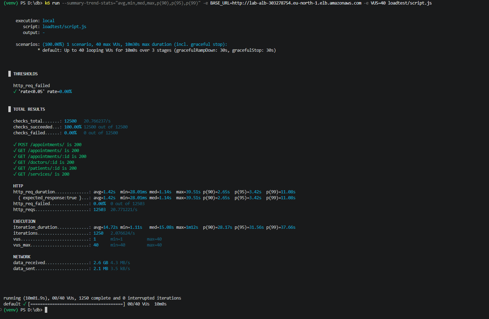
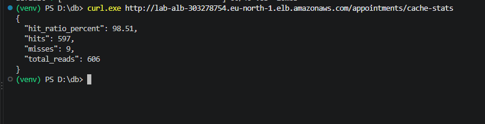
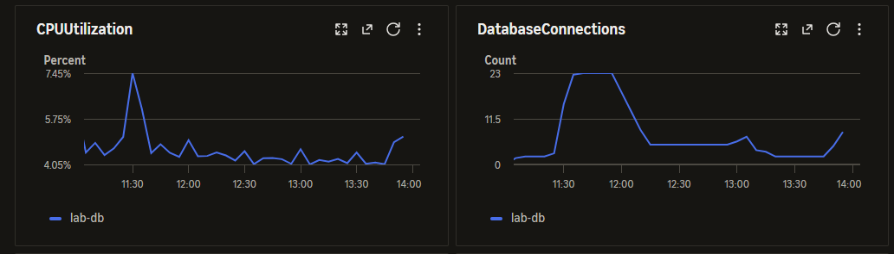
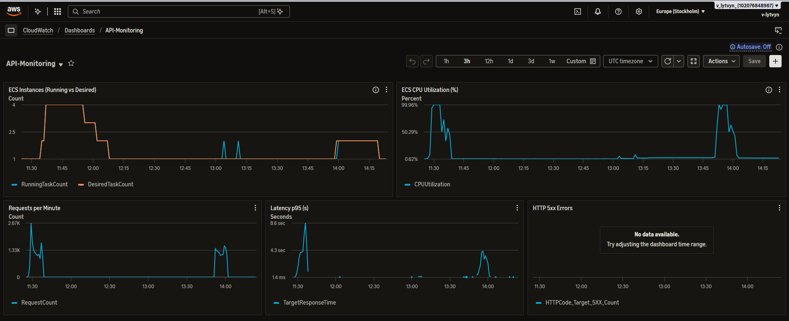

# Кешування

## Схема

Операцію `GET /appointments/` (отримання списку всіх записів на прийом) переведено на стратегію **cache-aside** у файлі `my_project/auth/route/appointment_route.py`:

1. При надходженні запиту застосунок перевіряє наявність ключа `appointments:all` у Redis.
2. Якщо запис знайдено і термін його дії не вичерпано (`X-Cache: HIT`) — список одразу повертається клієнту без звернення до бази даних.
3. Якщо ключа немає (`X-Cache: MISS`) — сервіс виконує вибірку з RDS MySQL, серіалізує дані у JSON, зберігає їх у Redis на **45 секунд** (`SETEX`) і віддає відповідь.

Redis (`redis:7-alpine`) розгорнуто сусіднім контейнером у межах того самого ECS Task Definition (`terraform/ecs.tf`) та підключено локально через `localhost:6379`. Робота кешу керується змінними оточення `CACHE_ENABLED` та `CACHE_TTL=45`.

## Результати

Два контрольні прогони сценарію з [LOADTEST.md](LOADTEST.md) — без кешування та з увімкненим кешем Redis (`TTL = 45 с`).

| Показник | Без кешу | З кешем Redis |
|---|---|---|
| Латентність `p95` | `8,6 с` | `3,42 с` |
| Максимум екземплярів ECS (`Auto Scaling`) | `4` | `2` |
| Пікове завантаження CPU бази RDS (`lab-db`) | `7,45%` | `~5,0%` |
| Максимум з'єднань з БД (`DatabaseConnections`) | `23` | `8` |

**Частка влучань у кеш: `98,51%`** (`597` влучань, `9` промахів із `606` запитів читання).

Кеш усунув майже всі повторні вибірки повного списку прийомів із бази даних: кількість одночасних підключень до RDS скоротилася майже втричі (з `23` до `8`), піковий CPU бази знизився з `7,45%` до фонового рівня `~5%`, а латентність `p95` зменшилася більш ніж удвічі — з `8,6 с` до `3,42 с`. Завдяки розвантаженню застосунку на серіалізації великих списків політика Auto Scaling обійшлася `2` контейнерами ECS замість `4`.

## Актуальність даних

Після додавання нового запису через `POST /appointments/` клієнт може бачити попередню закешовану версію списку **до 45 секунд** — поки не закінчиться термін дії запису в Redis.

Як зменшити час життя застарілих даних:
- зменшити значення `CACHE_TTL` - це прискорить оновлення даних, але збільшить кількість звернень до MySQL;
- очищати ключ `appointments:all` у Redis при кожній операції зміни даних (`POST`, `PUT`, `DELETE`) через виклик `redis_client.delete("appointments:all")`.