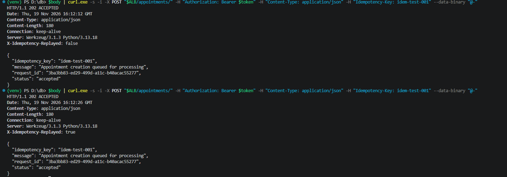

# Ідемпотентність операцій запису

## Схема

Ендпоінт створення запису `POST /appointments/` (`my_project/auth/route/appointment_route.py`) підтримує заголовок **`Idempotency-Key`**:

1. При першому запиті із ключем сервіс перевіряє наявність `idempotency:{key}` у Redis.
2. Якщо ключа немає — виконується обробка запиту (постановка завдання в чергу SQS), а сформована відповідь (`status_code` та JSON-тіло) зберігається в Redis із **TTL 24 години (`86400 с`)**. Клієнт отримує заголовок `X-Idempotency-Replayed: false`.
3. При повторному запиті з тим самим `Idempotency-Key` сервіс повертає збережену відповідь із Redis без повторного виконання операції та без відправки дубліката в чергу (`X-Idempotency-Replayed: true`).

## Результати тесту

Виконано два ідентичні `POST`-запити із заголовком `Idempotency-Key: idem-test-001`:

- **Перший запит:** статус `202 Accepted`, заголовок `X-Idempotency-Replayed: false`, згенеровано `request_id: "3ba3bb83-ed29-499d-a11c-b40acac55277"`.
- **Другий запит:** статус `202 Accepted`, заголовок `X-Idempotency-Replayed: true`, повернено ідентичну відповідь із тим самим `request_id: "3ba3bb83-ed29-499d-a11c-b40acac55277"`.
- **Результат у БД:** у чергу потрапило одне повідомлення, у базі створено один запис.

## Яку проблему це розв'язує

За HTTP-специфікацією метод `POST` не є ідемпотентним. Якщо під час запиту стається мережевий таймаут або обрив з'єднання, клієнт не знає, чи встиг сервер обробити запит. Повторна відправка (*retry*) без `Idempotency-Key` створить дублікат запису в базі даних. Збереження результату за унікальним ключем робить мережеві повтори безпечними.

## Поєднання із завданням 6 (черга повідомлень)

Ідемпотентність забезпечує захист на двох рівнях:

1. **На межі API:** дублікати HTTP-запитів від клієнта відсікаються через Redis (`idempotency:{key}`) ще до відправки повідомлення в чергу SQS.
2. **На рівні обробника (`worker.py`):** черга SQS працює за моделлю доставки *at-least-once* і може доставити одне повідомлення двічі. `Idempotency-Key` передається в тілі повідомлення, а воркер перед вставкою в MySQL виконує атомарну перевірку в Redis (`SET worker:processed:{key} 1 NX EX 86400`), що гарантує відсутність дублікатів у базі навіть при повторній доставці з черги.