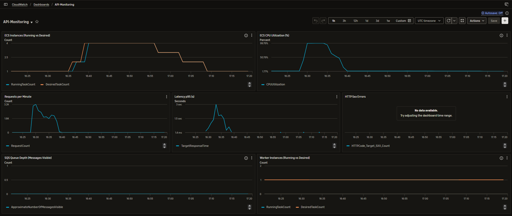

# Асинхронна обробка через чергу

## Схема

Операцію створення запису `POST /appointments/` (`my_project/auth/route/appointment_route.py`) переведено на асинхронну обробку через **Amazon SQS** (`terraform/queue.tf`):

1. Вебсервіс `lab-api-service` перевіряє JWT-токен, формує повідомлення з унікальним `request_id`, відправляє його в чергу `lab-appointments-queue` і одразу повертає клієнту статус **`202 Accepted`**.
2. Окремий сервіс-обробник `lab-worker-service` (`worker.py`) читає чергу методом long polling (`20 с`), зберігає запис у MySQL і видаляє повідомлення з черги після успішного запису.
3. Повідомлення, які не вдалося обробити після 3 спроб, перенаправляються в `lab-appointments-dlq` (Dead-Letter Queue).
4. Кількість екземплярів обробника масштабується від `1` до `4` за метрикою `ApproximateNumberOfMessagesVisible` (цільове значення — `10` повідомлень на екземпляр).

## Результати

Під навантаженням латентність API (`Latency p95`) залишається низькою і не залежить від швидкості запису в базу даних, оскільки сервіс лише кладе повідомлення в чергу. При зростанні довжини черги політика Auto Scaling збільшує кількість контейнерів обробника, а після її розбору повертає до `1`.

## Що змінилося для клієнта

Замість очікування завершення транзакції в базі даних і відповіді `200 OK` зі створеним об'єктом, клієнт миттєво отримує статус **`202 Accepted`** та `request_id`. Запис з'являється в системі з невеликою затримкою після обробки воркером (модель *eventual consistency*).

## Як клієнт дізнається результат

- **Polling:** клієнт періодично опитує API (наприклад, `GET /appointments/` або ендпоінт статусу за `request_id`), доки запис не з'явиться в базі.
- **Webhook:** обробник надсилає HTTP-запит на переданий клієнтом callback-URL після завершення операції.
- **WebSockets / SSE:** сервер передає сповіщення клієнту в реальному часі через відкрите з'єднання.

## Доставка «щонайменше один раз» і повторна обробка

- **Доставка «щонайменше один раз» (at-least-once):** брокер гарантує, що жодне повідомлення не загубиться, але при збої підтвердження видалення або перевищенні `visibility_timeout_seconds` (`60 с`) може доставити одне повідомлення повторно.
- **Наслідки повторної обробки:** без додаткового захисту повторна обробка створить дублікат запису в таблиці `Appointments`. У `worker.py` це усунуто атомарною перевіркою в Redis (`SET worker:processed:{key} 1 NX EX 86400`): дублікат пропускається без повторного запису в MySQL і видаляється з черги.