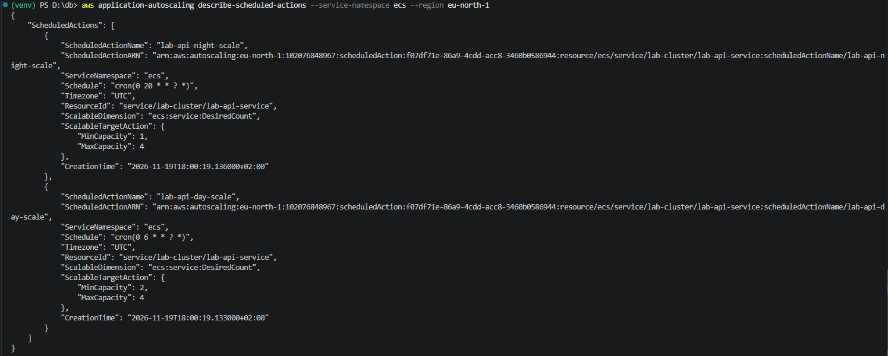
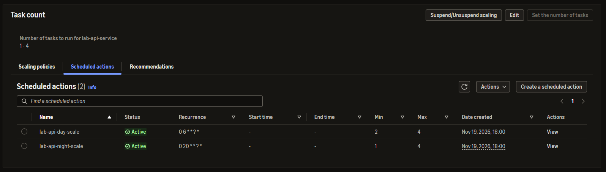

# Масштабування за розкладом

## Налаштування розкладу

Для сервісу `lab-api-service` у `terraform/autoscaling.tf` налаштовано дві дії `aws_appautoscaling_scheduled_action`:

| Період | Час (Київ / UTC) | Cron-вираз (UTC) | Мінімум задач | Максимум задач |
|---|---|---|---|---|
| **День** | `08:00 – 22:00` (`06:00 – 20:00 UTC`) | `cron(0 6 * * ? *)` | `2` | `4` |
| **Ніч** | `22:00 – 08:00` (`20:00 – 06:00 UTC`) | `cron(0 20 * * ? *)` | `1` | `4` |

Вночі мінімум встановлено на рівні `1`, а не `0`, оскільки за балансувальником Application Load Balancer зупинка всіх задач ECS призведе до помилок `503 Service Unavailable` замість автоматичного холодного старту.

## Перевірка конфігурації

## Розрахунок місячної економії

Параметри однієї задачі з `terraform/ecs.tf`: `256` CPU (`0,25 vCPU`) та `512 МБ` (`0,5 ГБ`) пам'яті. Розрахунковий місяць — `30 днів` (`720 годин`).

- **Без розкладу (постійно `2` задачі 24/7):**
  $$2 \times 24 \text{ год} \times 30 \text{ днів} = 1440 \text{ контейнер-годин/міс}$$
  Споживання: $360 \text{ vCPU-годин}$ та $720 \text{ ГБ-годин}$.

- **За розкладом (`2` задачі 14 год/день + `1` задача 10 год/день)[cite: 32]:**
  $$((2 \times 14) + (1 \times 10)) \times 30 \text{ днів} = 38 \times 30 = 1140 \text{ контейнер-годин/міс}$$
  Споживання: $285 \text{ vCPU-годин}$ та $570 \text{ ГБ-годин}$.

- **Місячна економія:**
  - **Ресурси:** $1440 - 1140 = \mathbf{300 \text{ контейнер-годин}}$ (**$75 \text{ vCPU-годин}$** та **$150 \text{ ГБ-годин}$**), що зменшує витрати на обчислювальні ресурси API на **$\mathbf{20,83\%}$**.
  - **Вартість:** $(75 \times P_{\text{vCPU}}) + (150 \times P_{\text{GB}})$ згідно з актуальними тарифами AWS Fargate для регіону `eu-north-1` (опубліковані на `aws.amazon.com/fargate/pricing/`).